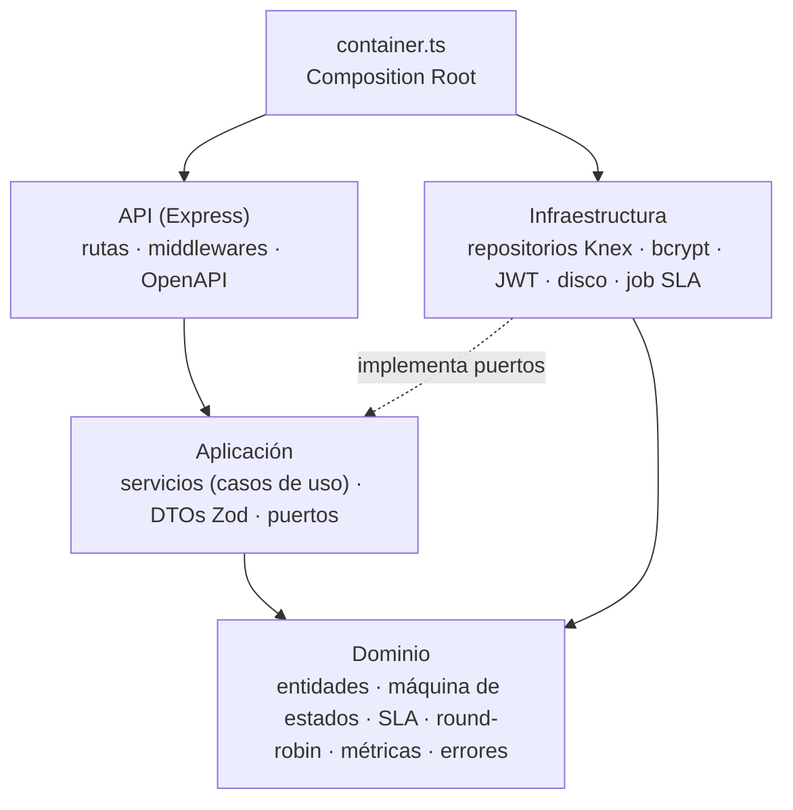
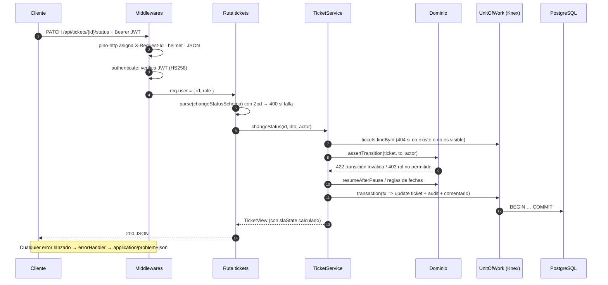

# Arquitectura

La API sigue una **arquitectura en capas inspirada en Clean Architecture (puertos y adaptadores)**. La regla principal: las dependencias del código apuntan hacia adentro, hacia el dominio. El dominio no sabe que existen Express, Knex o PostgreSQL.



## Capas

| Capa | Carpeta | Responsabilidad | Depende de |
|---|---|---|---|
| **Dominio** | `src/domain` | Tipos de negocio y reglas puras: transiciones válidas, cálculo de SLA, elección round-robin, fórmulas de métricas, errores de dominio. Sin E/S. | nada |
| **Aplicación** | `src/application` | Casos de uso (`TicketService`, `AuthService`…), DTOs validados con Zod y **puertos** (interfaces de repositorios, hasher, tokens, almacenamiento, reloj). Orquesta y aplica permisos. | dominio |
| **Infraestructura** | `src/infrastructure` | Adaptadores concretos: repositorios Knex, unidad de trabajo, bcrypt, JWT, almacenamiento local, logger, job de SLA, migraciones y seed. | aplicación, dominio |
| **API** | `src/api` | Traduce HTTP ⇄ casos de uso: autenticación, autorización por rol, parseo/validación, manejo global de errores (RFC 7807), documentación OpenAPI. | aplicación |
| **Composición** | `src/container.ts` | Único lugar donde se crean las implementaciones y se inyectan por constructor. | todas |

### Inyección de dependencias

Se usa **DI manual por constructor** (sin contenedor IoC ni decoradores). Ejemplo:

```ts
new TicketService(uow, storage, clock, logger, { autoAssignOnCreate })
```

En las pruebas se reemplaza el `clock` por un `FakeClock` para "adelantar" horas y verificar vencimientos de SLA de forma determinista.

## Flujo de una petición: `PATCH /api/tickets/:id/status`



## Decisiones clave

| Decisión | Motivo |
|---|---|
| Máquina de estados como **tabla declarativa** (`TRANSITIONS`) | Una sola fuente de verdad para validación, UI (`availableTransitions`) y documentación. |
| Permisos de transición por rol en el dominio | El usuario final solo cancela/cierra/reabre lo suyo; el técnico solo mueve lo que tiene asignado. |
| SLA en **horas calendario** con pausa en "en_espera" | Simple y explicable; la pausa evita penalizar al técnico cuando la demora depende del usuario. Horario laboral queda en el roadmap. |
| Estado del SLA **calculado al leer** + flag `sla_breached` persistido por el job | El estado siempre es exacto en tiempo real; el flag permite auditar y alertar una sola vez (idempotente). |
| Round-robin con `last_assigned_at` persistido | Justo entre reinicios y con varias réplicas; determinista para pruebas. |
| **Unidad de trabajo** con transacciones Knex | Cambio + auditoría son atómicos. |
| Número correlativo con *advisory lock* en PostgreSQL | Evita duplicados con creaciones concurrentes; `UNIQUE` como red de seguridad. |
| 404 (no 403) para tickets ajenos | No revela la existencia de recursos de otros usuarios. |
| Métricas calculadas en memoria | Misma fórmula en PostgreSQL y SQLite; suficiente para el volumen del demo (en producción: vistas/consultas agregadas). |

Ver también los ADRs en [`docs/decisiones/`](decisiones/).

## Seguridad

- Contraseñas con **bcrypt** (costo 12) y política mínima (8+, mayúscula y número).
- JWT con algoritmo fijado (`HS256`), expiración y validación del rol en el payload.
- `express-rate-limit` en login/registro; `helmet` para cabeceras; CORS restringido.
- Validación estricta de toda entrada (Zod) y ordenamiento solo por columnas en lista blanca (sin SQL dinámico).
- Adjuntos: lista blanca MIME, 5 MB máx., nombre físico UUID, descarga forzada (`Content-Disposition: attachment`).
- Logs con redacción de `Authorization` y contraseñas.
- Contenedores sin root (`USER node`, `nginx-unprivileged`).

## Observabilidad

- Logs JSON (pino) con `requestId`, método, ruta, estado y duración.
- Cabecera `X-Request-Id` propagada (respeta la que envíe un proxy).
- `GET /health` verifica la conexión a la base (`503` si está caída) y lo usa el `HEALTHCHECK` de Docker.
- El job de SLA registra `ALERTA: SLA de resolución incumplido` con número de ticket y técnico.
