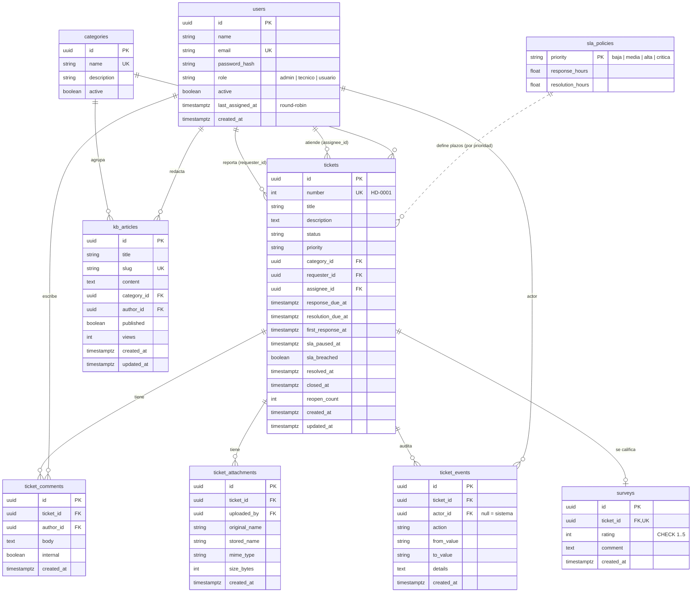

# Modelo de datos

Esquema creado por la migración `backend/src/infrastructure/db/migrations/001_esquema_inicial.ts` (portable entre PostgreSQL y SQLite).

## Tablas

| Tabla | Propósito | Notas de diseño |
|---|---|---|
| `users` | Cuentas y rol. | `email` único y normalizado a minúsculas. `last_assigned_at` sostiene el round-robin. Nunca se borra un usuario: se desactiva (`active=false`) para no romper la auditoría. |
| `categories` | Clasificación de tickets y artículos. | Desactivar oculta la categoría en formularios sin afectar históricos (`ON DELETE SET NULL`). |
| `sla_policies` | Plazos por prioridad. | Clave natural `priority`. Cambiarla afecta solo a tickets nuevos: el vencimiento se **copia** al ticket al crearlo. |
| `tickets` | Entidad central. | `number` legible y único. Las fechas de vencimiento se guardan (snapshot del SLA). `first_response_at`, `resolved_at` y `closed_at` permiten calcular métricas sin recorrer la auditoría. `sla_paused_at` ≠ null indica reloj detenido ("en_espera"). |
| `ticket_comments` | Conversación. | `internal=true` solo visible para técnicos/admin. |
| `ticket_attachments` | Metadatos de archivos. | El binario vive en disco (`UPLOAD_DIR/<ticketId>/<uuid>.<ext>`); `stored_name` nunca usa el nombre del cliente. |
| `ticket_events` | Auditoría *append-only*. | Acciones: `creado`, `estado_cambiado`, `asignado`, `prioridad_cambiada`, `comentario_agregado`, `adjunto_agregado`, `sla_incumplido`, `encuesta_respondida`. `actor_id` nulo = acción del sistema (job). |
| `surveys` | Satisfacción (CSAT). | `UNIQUE(ticket_id)`: una encuesta por ticket. `CHECK rating BETWEEN 1 AND 5`. |
| `kb_articles` | Base de conocimiento. | `slug` único para URLs amigables; `published` separa borradores. |

## Índices

`tickets(status)`, `tickets(priority)`, `tickets(assignee_id)`, `tickets(requester_id)`, `tickets(created_at)`, `ticket_comments(ticket_id)`, `ticket_attachments(ticket_id)`, `ticket_events(ticket_id)`, `users(role)`, `kb_articles(published)` — cubren los filtros de las colas de trabajo y la carga del detalle.

## Convenciones

- Identificadores **UUID** generados en la aplicación.
- Fechas en UTC (`timestamptz` en PostgreSQL; ISO-8601 en SQLite). La UI las muestra en `America/Lima`.
- Nombres de columnas en `snake_case`; el mapeo a `camelCase` se hace en los repositorios.
